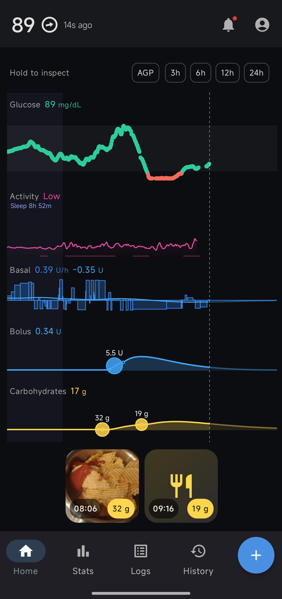
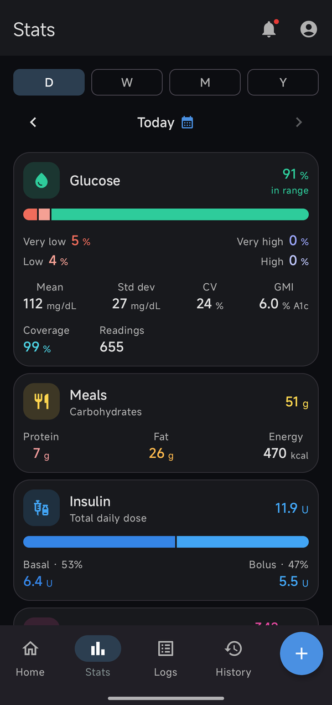
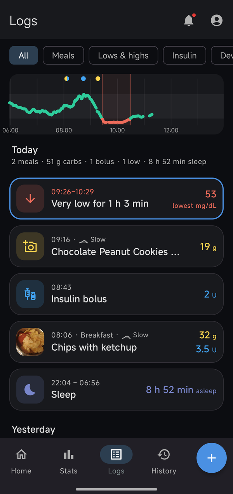
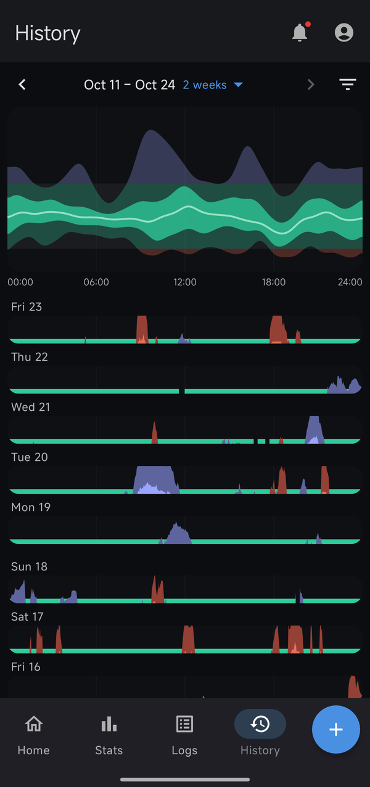

# Diafit

Diafit is an Android app for people with diabetes. It brings glucose, insulin, meals, activity and sleep together on one screen, so you can see how they affect each other and spot patterns in your own data.

> 🚧 Diafit is a personal project under active development. It is **not a medical device**, it does not give dosing advice, and it must not replace your own judgement or your care team.

<p align="center">
  
  
  
  
</p>

## 🔒 Your data stays on your phone

- Everything Diafit collects (glucose, insulin, meals and photos, activity, sleep, settings) is stored **only in the app's private storage on your device**.
- There is **no Diafit account, no Diafit server, no advertising and no analytics or crash reporting**. The developer cannot see your data.
- Diafit connects to the internet only for things **you** switch on, each of which sends only what that feature needs:
  - **Nightscout**: if you connect your own Nightscout site, Diafit talks to that site (and nothing else).
  - **AI features** (optional, see below): only the photo and note you choose to analyse are sent, to the AI service **you** configured.
  - **Food databases**: when you scan a barcode or search for a food by name, that barcode or search text is sent to [Open Food Facts](https://world.openfoodfacts.org/) (and to [USDA FoodData Central](https://fdc.nal.usda.gov/) if you added a key).
  - **Backend sync** (optional, off until you set it up): uploads to a server **you** run.
- Data from Health Connect, AAPS, xDrip+ and Juggluco is read on the phone itself.
- Android's own system backup may include app data if you have device backup enabled in your phone settings; that is controlled by Android, not by Diafit.

## ✨ Features

- 📈 **One shared timeline**: glucose, activity, basal, bolus and carbohydrate charts that pan and zoom together; hold to inspect any moment.
- 🍽️ **Meal logging** with photos, multi-course meals, barcode scanning, food search and your own recipes. Carbs from AAPS are matched to the meals you log.
- 🧾 **Logs**: a daily journal of meals, boluses, lows and highs, sleep, workouts and pump or sensor changes.
- 📊 **Stats** per day, week, month and year: time in range, GMI, variability, insulin, meals, steps, heart rate, sleep.
- 🗓️ **History**: an ambulatory glucose profile (AGP) and one compact row per day, with optional meal, insulin, activity and sleep layers.
- 🧠 **Patterns**: finds recurring things in your own data (for example "low glucose in the evening", or "rise after late dinners") and shows real example days from your history.
- 🩺 **Device ages and alerts** for sensor, pump site, insulin and battery, with reminders before they expire.
- 🌍 English, German and Italian.

## 🤖 AI features are optional

Diafit works fully without AI, and **AI is switched off after installation**. The AI features are:

- **Meal estimation**: estimate nutrients from a meal photo, after you press "Estimate nutrition".
- **Daily recap**: a short written summary of the previous day.

How they work:

- They use an **OpenAI-compatible service that you provide** (base URL and API key). Without a connection and key, nothing can be sent.
- Photos and text are sent **only when you ask for an estimate** (or when the daily recap runs, which only sends a compact numerical summary and no photos).
- You turn AI on in **Account menu → AI** (and can switch meal estimation or the daily recap off separately again). Every request is listed in a log on the same page, so you can see exactly what was sent.
- Estimates can be wrong. Always check the numbers before relying on them.

## 🔌 Supported data sources

You choose, per kind of data, which connected app provides it. Connected apps can be switched on in **Account menu → Connected apps**.

| App | Used for |
|---|---|
| [Nightscout](https://nightscout.github.io/) | glucose, insulin, carbs, basal, profile switches, device changes, plus filling in past data |
| [AAPS (AndroidAPS)](https://github.com/nightscout/AndroidAPS) | boluses, carbs, temp basals, profile switches, pump and device events |
| [xDrip+](https://github.com/NightscoutFoundation/xDrip) | glucose |
| [Juggluco](https://github.com/j-kaltes/Juggluco) | glucose |
| [Health Connect](https://health.google/health-connect-android/) | heart rate, steps, sleep, workouts, calories (and glucose written by other apps) |

## 📲 Install

1. Download the latest APK from the [Releases page](https://github.com/scimone/diafit-android-app/releases).
2. Open it on your phone and allow installing from your browser or file manager when asked.
3. Releases are all signed with the same key, so later versions update in place and keep your data.

The first launch walks you through a short setup (connect your data, notifications); every step can be skipped. Requires Android 9 or newer (API 28).

## 🛠️ Build from source

```
./gradlew assembleDebug      # debug APK
./gradlew test               # unit tests
```

You need JDK 17 and the Android SDK (compile SDK 37).

## 🧱 Under the hood

Kotlin and Jetpack Compose, Clean Architecture with MVVM, Room, Koin, Ktor, [Vico](https://github.com/patrykandpatrick/vico) charts, WorkManager, CameraX and ML Kit (barcode scanning). Features are organised as packages under `app/src/main/java/uk/scimone/diafit/`.

## 📄 License

MIT, see [LICENSE](LICENSE).
